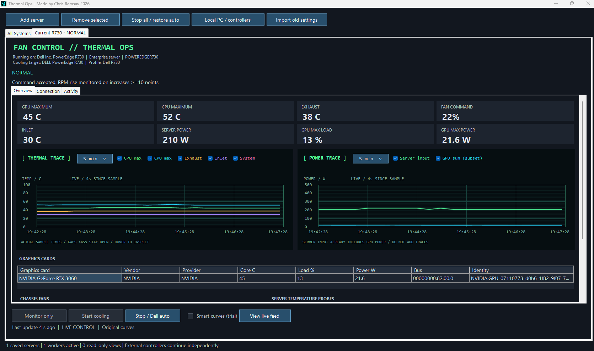

# Thermal Ops

Made by **Chris Ramsay, 2026**. Windows cooling control and monitoring with a dark dashboard, live temperature trends, individual server power graphs, fleet health and total power usage.



## Multiple servers / fan-farm management

Add multiple iDRAC servers by IP address or hostname. Each server has its own saved login, monitoring worker, temperature and power graphs, and cooling mode. **All Systems** combines health status and current reported power; **Stop all / restore auto** requests an orderly stop for owned controllers. Compatibility is checked independently for every server.

For remote servers with GPUs cooled by chassis fans, run the R730 curve controller on that server so it can read the matching local GPUs. Server-only mode requires confirmation that there are no chassis-cooled GPUs. The dashboard can follow an existing controller feed.

## Downloads

Use the ready-made **MSI or EXE installer** from **Releases** for the graphical app. Both include the complete application and bundled tools. [MSI installation and migration instructions](Installer/MSI.md). The console ZIP keeps the original ASCII PowerShell dashboard available. The installer is unsigned; Windows may display a publisher warning.

## Updates

Version 1.4.0 adds **Check for updates** on the dashboard and tray menu. A background check runs once at startup; turn it off with **Check for updates at startup** in the tray menu. Only newer stable GitHub releases are offered. No account or server information is sent to GitHub; checks use the public release API.

Download and installation always require your choice. The updater matches your MSI or EXE installation, checks the asset size and GitHub SHA-256 digest, then requests safe controller shutdown. Setup starts only after the dashboard exits and the helper confirms no other Thermal Ops cooling workers remain. Profiles/settings are preserved. If you cancel setup, reopen Thermal Ops to resume your configured controllers. Portable copies are directed to the release page instead of being converted automatically.

Install 1.4.0 normally once to obtain the updater; older versions cannot discover it themselves. [Updater details and tests](docs/UPDATES.md).

## Hardware support

- **Dell iDRAC / IPMI:** general temperature, fan and whole-server power monitoring without requiring the R730's six-fan/two-CPU layout. Missing values stay unknown. Unsupported model/firmware combinations automatically remain read-only, even if Start cooling was requested.
- **Dell R730 manual curves:** limited to the recorded model/controller fingerprint (IPMI revision 2.86, auxiliary 00065656). Other R730 firmware remains monitoring-only until verified; no firmware downgrades are recommended.
- **Dell iDRAC / Redfish:** capability-dependent minimum-fan control that retains Dell automatic cooling. Choose **Dell iDRAC (Redfish fan minimum)** when adding a server. On Connection select **DellMinimum**, enable **Dell min fan %**, and choose a value within the firmware's advertised bounds and no lower than the existing floor. Original settings are saved, read back, and restored on stop. This adapter is fixture-tested, not physically certified across iDRAC generations.
- **HPE / other Redfish servers:** monitoring and capability-dependent controls. HPE thermal profiles and minimum fan settings require the firmware to expose them. These adapters have offline fixture tests; they have not been validated on physical HPE hardware.
- **Local PCs:** LibreHardwareMonitor sensor discovery and supported fan outputs. Select and verify the physical fan channels and temperature sources before enabling control. Not every GPU, motherboard, USB controller or laptop exposes writable controls.

See [hardware support](R730-App-Fleet/HARDWARE-SUPPORT.md), [HPE support](R730-App-Fleet/HPE-SUPPORT.md) and [GPU compatibility](R730-App-Fleet/GPU-COMPATIBILITY.md).

The GUI stores separate server credentials protected for the current Windows user. Closing the window hides it in the tray. Use **Exit** to stop controllers and request restoration of automatic cooling. Configure startup behaviour only after verifying your sensors and cooling response.

## Automatic reconnection and exit reasons

Version 1.4.1 reconnects owned Dell IPMI workers after temporary command or telemetry failures, with a capped retry delay and three complete readings before takeover. Stop/Exit cancel retries. Hardware safety faults stay stopped for review. [Exit reasons and recovery behaviour](docs/RECOVERY.md).

## Hardware support requests

For an unsupported system, start **Monitor only**, wait for detection, and click **Hardware support request**. Review the report, choose **Copy report**, then **Open GitHub issue** and paste it into the template. The report includes model, firmware, sensor inventory, read-only IPMI SDR sensor numbers/entity IDs, available local sensor identifiers, successfully read Redfish resource paths and exposed cooling capabilities. These are query locators, not fan-write commands. It excludes credentials, IP addresses, hostnames, service tags, GPU identifiers and raw logs. Nothing is posted automatically and no fan-control probe is issued.

See [iDRAC compatibility](R730-App-Fleet/IDRAC-COMPATIBILITY.md) for version research, support limits and the evidence needed to add another control profile.

## Console version

Requires Windows PowerShell 5.1 and a Windows ipmitool executable. Set connection details in the current PowerShell session:

```powershell
$env:THERMAL_OPS_IDRAC_HOST = '192.0.2.10' # replace with your management address
$env:THERMAL_OPS_IDRAC_USER = 'root'
$env:THERMAL_OPS_IPMITOOL = 'C:\Tools\IPMI\ipmitool.exe'
.\R730-FanController-Smart.ps1
```

The password is requested securely when it is not supplied through `THERMAL_OPS_IDRAC_PASSWORD`. Default mode monitors without issuing fan control commands. After checking telemetry, use `-Live` to enable control. `R730-FanController.ps1` provides the original curve implementation; the Smart variant adds smoothing. Both preserve the ASCII dashboard and R730 thresholds. Live console control uses the same recorded firmware gate as the GUI; these scripts do not become generic server controllers.

Run only one controller against a physical server. These console scripts are R730-specific; never apply their raw commands to an unverified model. Abrupt termination, power loss or an operating system crash can prevent software restoration: keep independent hardware temperature protection enabled and check the result of exit restoration.

Offline checks (no hardware writes):

```powershell
.\Test-R730FanController.ps1
.\Test-R730SmartControl.ps1
.\Installer\Test-DellCompatibility.ps1
.\Installer\Test-DellRedfish.ps1
```

## Build the Windows app

Requires Windows, .NET Framework 4.7.2 or newer, Windows PowerShell 5.1 and Inno Setup 6. Download the matching **build-dependencies** ZIP from Releases and extract it in the repository root; it supplies `Installer/Payload` with runtime dependencies and their licences. Then run:

```powershell
.\Installer\Build.ps1 -InnoCompiler 'C:\Program Files (x86)\Inno Setup 6\ISCC.exe'
```

Output: `Dist/Thermal-Ops-Setup-1.4.1.exe`. The dependency archive includes upstream binaries, licence notices and required corresponding source archives. LibreHardwareMonitor 0.9.6 comes from its official GitHub release; PawnIO 2.1.0 is its bundled driver installer. The Windows ipmitool 1.8.19 build is distributed by Danny Nieuwenhuis, with provenance and hashes in `Installer/Payload/Tools/IPMI`. The optional PawnIO driver requires a separate installation with administrator approval.

## Licence

Thermal Ops code is [MIT licensed](LICENSE). Third-party software keeps its own licence; bundled notices and corresponding sources are distributed with the installer and dependency archive. Do not upload saved profiles, passwords, logs or telemetry when reporting an issue.
