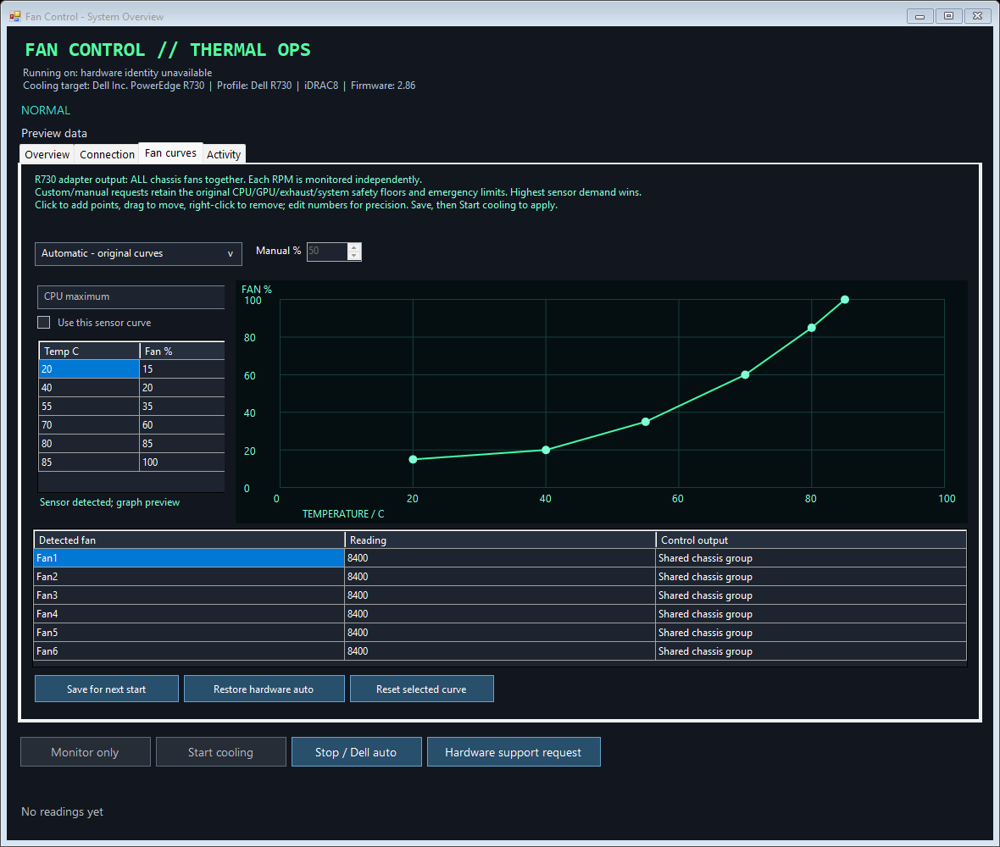
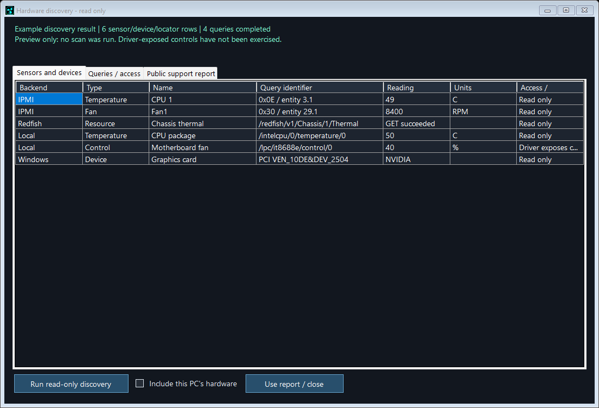

# Fan curves and hardware discovery

Version 1.5.0 replaces the old Smart curves checkbox with the third server tab, **Fan curves**. Overview, Connection and Activity remain available. The unused View live feed button is removed. The all-server tab and power graph now use **Cluster** wording. Existing history file names are retained so recorded data remains available.

## Using the editor

Start **Monitor only** to populate detected fans and temperature sources. Stop the monitor, select a mode and edit the settings. Save with **Save for next start**, then choose **Start cooling** to apply. A cooling start also captures the current valid editor settings. Settings remain per server. Use **Connection → Server name → Rename server** to change a display name; this preserves the profile directory, endpoint, credentials and history, and can be done while monitoring/cooling.

| Mode | Behaviour |
| --- | --- |
| Automatic - original curves | Existing R730 curves and thresholds |
| Automatic - adaptive curves | Existing smart algorithm; old Smart=true settings migrate here |
| Automatic - custom graph | Enabled sensor curves use linear interpolation; the highest demand wins |
| Manual % - safety protected | Requests a minimum duty; original thermal demand can raise it |

Select a detected temperature source, enable **Use this sensor curve**, then edit its graph. Left-click empty graph space to add a point, drag a point to move it, or right-click a point to remove it. The table provides exact temperature/% inputs. Curves require 2–12 points with increasing temperatures and nondecreasing fan percentages. Missing required custom sensors stop takeover and follow the telemetry recovery policy.

The original CPU/GPU/exhaust/system curves remain a safety floor in Custom and Manual modes. Emergency thresholds, GPU cooldown, startup checks, fan-response checks and telemetry recovery remain active. Increases are immediate; decreases retain the existing 20-second hold and 3-point step. Startup retains the 60% floor. The plotted draft is not necessarily the final applied percentage because original thermal demand can be higher. Editing never writes fan commands directly. Active workers lock curve editing/saving. Restore hardware auto requests the existing safe stop; for an external feed the action is labelled Stop viewing.

The implemented Dell R730 transport controls the **whole chassis fan group**. Every fan's RPM is listed independently, but separate RPM readings do not establish independent control. Unsupported model/firmware combinations remain monitoring-only. Native Redfish and local-controller adapters show available inventory but retain their existing controls instead of using the R730 graph writer. This release does not claim per-channel custom control across every adapter.

## Individual R730 fan-control research

Some community command references describe replacing the all-fan selector with an individual target, including [this R730xd reference](https://github.com/rubemdiogo/dell-R730xd). However, a separate project's [reported R730xd/iDRAC 2.82 test](https://github.com/mason369/dell-poweredge-r730xd-fan-control/blob/main/README.en-US.md) caused all fans to ramp high when selector 0x00 was used. It therefore disables individual control by default. Neither result establishes the mapping or behaviour on this user's R730/firmware fingerprint. No individual-fan command was sent during this work; no unverified mapping was added to Thermal Ops.

[Dell's R730 thermal settings documentation](https://www.dell.com/support/manuals/en-aw/poweredge-r730/r730_ompublication/changing-the-thermal-settings?guid=guid-6aa43bf5-38bb-49c3-9f28-adba64d3ac88&lang=en-us) describes the supported thermal profile, offsets and minimum fan options. It does not establish the individual OEM command mapping above.

The editor design follows established graph-curve interactions, interpolation and minimum-duty/response controls described in [Fan Control's primary documentation](https://getfancontrol.com/docs/). Thermal Ops keeps its own existing safety policy; no external application's code was copied.

The preview uses fixture readings, not live measurements.

## Explicit read-only discovery

**Hardware support request → Run read-only discovery** opens a separate dialog with progress and three tabs:

- **Sensors and devices:** backend, sensor/device type, name, query identifier, reading, units and access/capability description.
- **Queries / access:** completed and unavailable queries. Missing data is not interpreted as proof of no hardware support.
- **Public support report:** reviewed output ready to return to the report/copy workflow. Nothing is automatically posted to GitHub.

The normal support button initially compiles the current worker snapshot. The explicit discovery action performs fresh bounded queries. Remote discovery uses generic read-only IPMI identity/SDR/sensor commands and Redfish GET discovery without a model-specific control allowlist. It follows only same-origin HTTPS Redfish resources, caps query/row counts and time, and reports access failures. Existing TLS trust requirements apply. It never issues raw IPMI fan commands or Redfish PATCH operations.

Local discovery uses Windows hardware identity and the installed LibreHardwareMonitor backend. Probe mode requests CPU, GPU, motherboard, controller, memory, storage, network, PSU, battery and power-monitor providers. Results depend on hardware, exposed drivers and permissions. It does not install a driver or calibrate fans. If an active local worker owns the hardware interface, the separate driver scan reports unavailable/busy instead of interrupting cooling. The existing snapshot can still show that worker's temperatures/fans.

Select **Include this PC's hardware** to request local inventory alongside remote discovery. For an unconfigured loopback profile this becomes a local-only scan. Listed control channels say **Driver exposes control; writes not tested**. This is not certification that every gaming motherboard, USB hub, laptop or server is controllable.

Credentials and management endpoints are excluded from exported results. Known serials, local hostname, UUIDs and unique device-instance identifiers are scrubbed or omitted. Non-unique PCI vendor/device signatures may be included. Public-report identifiers are limited to recognised sensor/resource locator formats; review the report before posting.

The dialog preview uses example devices; it does not certify control support for those channels.

## Rendering and validation

The tab frames and layout/grid containers use buffered rendering. Graph updates invalidate the plot, hidden plots skip timer redraws, duplicate samples do not trigger a second redraw, and the cluster table updates existing cells rather than clearing/recreating rows every second. These changes address the reported border flashing; real display/GPU confirmation still depends on the user's environment.

Validation includes curve interpolation/bounds and thermal-floor fixtures; an actual worker with a simulated IPMI transport applying a custom curve after three valid samples; generic server and local-PC discovery fixtures; credential/identifier filtering and foreign-Redfish-resource rejection; editor persistence/locks, rename retention and tab order; and the existing UI, history, cluster, shutdown and reconnection checks. Physical fan-control writes were not used.

The public `ThermalBrand.ReverseEngineeringNote` constant and nearby comment include the author's requested message for decompiler/source readers. Its presence cannot force an external AI tool to display it.
